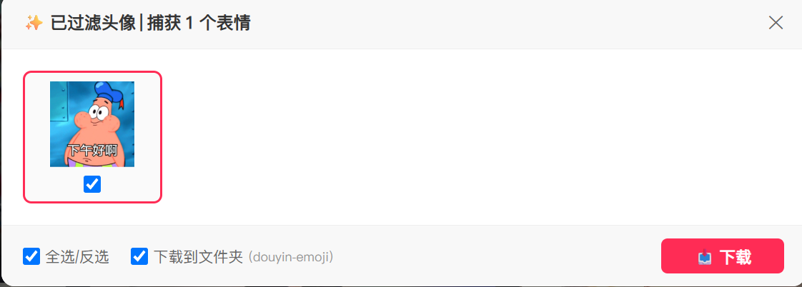

  
  <h1>抖音私信表情包提取器</h1>
  
<b>Douyin Emoji Downloader</b>

  
  [中文](#中文) | [English](#english)

---

## 🇨🇳 中文说明

一款轻量、极简的浏览器扩展程序（Chrome & Edge），专为抖音网页版（douyin.com）私信对话设计。支持在私信聊天界面中一键唤醒面板，可视化勾选并批量下载表情包，自动整理归类至本地专属文件夹。

### ✨ 核心特性

- **可视化勾选**：自动识别私信聊天记录中的所有表情包图片，提供直观的缩略图网格预览。
- **一键全选 / 反选**：内置便捷的批量操作按钮，轻松筛选目标表情包。
- **自动新建文件夹**：支持一键勾选“保存至 `douyin-emoji` 文件夹”，自动将所有提取的表情存入 Downloads 默认路径下的独立子目录，避免文件杂乱。
- **支持多种格式**：完美兼容静态图片（WebP、PNG等）与动态表情包（GIF）。

### 🖼️ 效果预览

| 功能界面预览 1 | 功能界面预览 2 |
| :---: | :---: |
|  |  |

### 🚀 安装教程

1. 前往本项目的 [Releases](../../releases) 页面，下载最新的 `v1.0.0` 离线安装包（`.crx` 或 `.zip`）。
2. 如果下载的是 `.zip` 文件，请先解压到本地文件夹。
3. 打开 Chrome / Edge 浏览器，在地址栏输入并访问：
   - **Chrome**: `chrome://extensions/`
   - **Edge**: `edge://extensions/`
4. 在页面右上角开启 **“开发者模式 (Developer mode)”**。
5. **安装扩展**：
   - **使用文件夹**：点击左上角 **“加载已解压的扩展程序”**，选择解压后的文件夹。
   - **使用 .crx**：直接将 `.crx` 文件拖拽至扩展管理页面中放开即可完成安装。

### 🛠️ 使用说明

1. 打开 [抖音网页版 (douyin.com)](https://www.douyin.com) 并登录账号。
2. 进入**私信聊天界面**，打开包含表情包的对话框。
3. 点击页面上的“提取表情包”悬浮按钮，唤醒提取面板。
4. 在面板中查看自动加载的表情包缩略图，勾选需要保存的表情（或点击“全选”）。
5. 勾选 **“下载到文件夹 (douyin-emoji)”** 选项，点击 **“批量下载”** 按钮即可。

> **💡 注意事项**：  
> 如果下载时文件未自动进入 `douyin-emoji` 文件夹，请前往浏览器的 **“设置 ➔ 下载”** 中，**关闭“下载前询问每个文件的保存位置”** 选项。

### ⚠️ 免责声明

免责声明 (Disclaimer)：本项目为开源学习与个人交流工具，与“抖音”及“字节跳动 (ByteDance)”官方无关。项目中涉及的“Douyin”商标权归其原权利人所有。

### 📄 开源许可

本项目基于 MIT License 开源，仅供个人学习与交流使用。

---

## 🌍 English Version

A lightweight and minimal browser extension (Chrome & Edge) designed for Douyin Web (douyin.com) direct messages. It allows you to trigger a panel inside chat conversations to visually select and batch-download emoji stickers, automatically organizing them into a dedicated local folder.

### ✨ Features

- **Visual Selection**: Automatically detects all emoji stickers in direct messages and provides an intuitive grid preview.
- **Select All / Invert**: Built-in convenient batch operation buttons to easily filter target stickers.
- **Subfolder Auto-creation**: Toggle option to save files directly into a dedicated `douyin-emoji` subfolder under your default Downloads path.
- **Multi-format Support**: Fully supports static images (WebP, PNG, etc.) and animated stickers (GIF).

### 🖼️ Screenshots

| Preview 1 | Preview 2 |
| :---: | :---: |
|  |  |

### 🚀 Installation

1. Go to the [Releases](../../releases) repository page and download the latest `v1.0.0` release (`.crx` or `.zip`).
2. If you downloaded a `.zip` file, extract it to a local folder first.
3. Open Chrome or Edge and navigate to:
   - **Chrome**: `chrome://extensions/`
   - **Edge**: `edge://extensions/`
4. Enable **"Developer mode"** in the top-right corner.
5. **Install Extension**:
   - **Unpacked Folder**: Click **"Load unpacked"** in the top-left and select your extracted folder.
   - **CRX Package**: Drag and drop the `.crx` file onto the extension management page.

### 🛠️ How to Use

1. Visit [Douyin Web (douyin.com)](https://www.douyin.com) and log in.
2. Open a direct message chat containing emojis.
3. Click the floating "Extract Emojis" button on the webpage to open the visual panel.
4. Preview the loaded emojis, then select desired ones or click "Select All".
5. Optionally check **"Save to subfolder (douyin-emoji)"** and click **"Batch Download"**.

> **💡 Note**:  
> If files are not saved to the `douyin-emoji` folder, please go to Browser **Settings ➔ Downloads** and **disable "Ask where to save each file before downloading"**.

### ⚠️ Disclaimer

Disclaimer: This project is an open-source tool for personal learning and communication purposes only and is not affiliated with, authorized, or endorsed by "Douyin" or "ByteDance". The trademark "Douyin" belongs to its respective owners.

### 📄 License

This project is licensed under the MIT License and is intended solely for personal learning and communication purposes.
